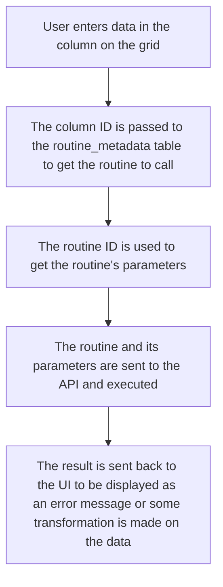

# Metadata Driven UI
## Overview

Vantage is a construction accounting application with a large relational database and numerous data-management interfaces. Early in development, I decided that each applicable database table should have a grid view in addition to a form-based interface.

Building and maintaining individual grid components for every table would introduce substantial code duplication, increase development time, and make changes to common functionality difficult to maintain consistently.

To address this, I designed a metadata-driven UI framework using React and AG Grid. Instead of defining each grid manually, the application retrieves metadata describing the underlying database table and its columns, then dynamically constructs the interface at runtime.

This approach centralizes grid configuration, reduces repetitive code, and allows new data-management interfaces to be created primarily through metadata configuration rather than custom frontend development.

## Metadata Structure
There are two main tables underlying the metadata-driven UI:
1. table_metadata
2. column_metadata

### table_metadata
The table_metadata table defines the database tables available to the metadata-driven UI. Each record is referenced by corresponding records in column_metadata through a foreign key relationship, ensuring that column configurations are associated with a valid metadata table entry.  In addition to its identifying and relational fields, table_metadata stores database_table_name, which provides a programmatic table identifier, and ui_table_name, which defines the human-readable name displayed in the interface.

### column_metadata
This is the table that stores the information that the app needs to construct the grid dynamically.

It has the following columns:
| Column Name | Purpose |
|---------------|---------------|
| database_column_name | A "code-friendly" way of referencing the record.  Similar to database_table_name on table_metadata. |
| ui_column_name | A nice-looking name to use on the page.  Similar to ui_table_name on table_metadata. |
| column_order | The order that the column should be in the grid. |
| datatype | The database data type of the column.  The options are: String, Int, Decimal, Datetime and Boolean. |
| input_type | How the app will handle the column for display.  The options are: Input, Date, Checkbox and Dropdown.  Having this separate from the datatype column allows for more flexibility, such as having a string value that displays as a dropdown in the UI. |
| nullable | Used by the app to determine if the column allows for nullability.  Can be used to prevent the app from saving records as empty strings. |
| mutable | Used by the app to determine if the column allows for mutability.  This is useful for columns that need to show up in the UI, but we don't want the user to think the data can be changed there; often in the context of joined tables.  An example would be addresses on vendors, the address is set with a dropdown, but the full address is shown in gray-out boxes next to it for readability. |
| visible | Used by the app to determine if the column should appear on the UI.  There are situations where data needs to be captured on a table, but should not be visible on the grid.  An example would be the company number, most tables reference the company that the record is associated with, but it would be redundant to display it on the grid, since it is handled with a context and the user would already know the selected company. |

Using this metadata, the grid determines which columns are visible, which editors to provide, and whether values can be modified. The same generic React component can therefore support different database entities without requiring separate column definitions for each interface.

## Dynamic Column Generation
When a user navigates to a page, an API call is made to the database to retrieve the table metadata and column metadata.  That information is then passed on to a React component that builds the grid column-by-column.  Changing the metadata in the table_metadata or column_metadata tables will change how the grid appears in the app.

This makes it faster and easier to make seemingly application-level changes by only updating a record in the database.  It also places the structure of the app in a highly visible and easy to access, single source of truth location.

The data from the column_metadata table is passed to the AG Grid, where it is used to configure the grid.  Some data, like column-order, is not used by the app, but is instead used in the API when querying the table to order the results by it.  Other columns, like input_type, are used with a simple switch-case block to determine what the app needs to do for that column.

#### Illustrative Code
```
const colDefs = useMemo(() => {
  return columnMetadata.map((column) => {
    const colDef: ColDef = {
      field: column.DatabaseColumnName,
      headerName: column.UIColumnName,
      editable: column.Mutable,
      hide: !column.Visible,
    };

    switch (column.InputType.toLowerCase()) {
      case "date":
        colDef.cellEditor = "agDateStringCellEditor";
        break;

      case "checkbox":
        colDef.cellRenderer = "agCheckboxCellRenderer";
        colDef.cellEditor = "agCheckboxCellEditor";
        break;

      case "dropdown":
        colDef.cellEditor = "agRichSelectCellEditor";
        break;

      default:
        colDef.cellEditor = "agTextCellEditor";
    }

    return colDef;
  });
}, [columnMetadata]);
```

This simplified example illustrates how the grid maps metadata values to AG Grid editors. The actual implementation also considers field mutability, visibility, data types, and additional configuration requirements.

## Editing and State Management
### CRUD Operations
The metadata-driven grid supports inserting, updating, and deleting records through the application's REST APIs.  Insert operations use a dedicated row pinned to the top of the grid. After successfully inserting a record, the grid preserves the empty insertion row, allowing users to continue entering records without navigating away.  After an insert operation, the grid maintains this row so users can continue adding records without navigating away from the page.  

Delete operations collect the unique identifiers of selected records and submit them to the appropriate REST API endpoint for removal.

Update operations identify modified records and fields, validate required values and constraints, and construct API requests that preserve unchanged data.

### Change Tracking and Cancellation

The grid maintains a snapshot of the last synchronized dataset alongside its current editable state.

Modified records are tracked separately, allowing the application to identify pending changes without unnecessarily updating unchanged records.

When a user cancels pending changes, the grid restores the previously synchronized snapshot and clears the modification state.

This allows users to discard unsaved edits without requiring another database query.

### State Synchronization

Maintaining this state becomes more complex after successful inserts, updates, or deletes.

The application must update its local baseline to reflect persisted changes while ensuring that subsequent edits can still be canceled independently.

This design minimizes unnecessary database requests and avoids requiring a full page refresh after individual operations.

## Validation Integration
Validations, which are known as "routines" in the database was a process that was layered onto the grid.

The high-level overview of how it works:


If a validation returns an error, it notifies the user and prevents saving until the error is resolved.

The principle is similar to table_metadata and column_metadata; the database operates as the highly visible source of truth and changes that seem to affect the application are made in the database.

The client is responsible for initiating validation and presenting the result, while routine resolution and database execution occur through the application's server-side API.

<i>This was a recently added feature that is still undergoing testing, bug fixes and process revisions.  It should be understood as a work in progress component.</i>

## Design Decisions
### Upfront Complexity vs. Long-Term Maintainability

The cost-benefit of this design choice was largely where I wanted to invest my time: higher upfront cost now or higher cost later.  I chose to accept the higher initial development cost because I expected the long-term maintenance and implementation benefits to outweigh it as the application grew.  Although the framework required substantial upfront development, it has reduced the time required to configure and introduce a new grid interface to approximately 30 minutes or less in most cases.

### Centralized Configuration

Storing table and column definitions in database metadata creates a centralized configuration model.

Changes to visibility, column order, display names, and editing behavior can be applied through metadata rather than modifying individual frontend components.

This also simplifies maintenance by reducing the number of places where shared grid behavior must be implemented.

### Architectural Tradeoffs

The metadata-driven approach introduces additional complexity around runtime configuration, state management, validation, and debugging.

Changes to shared grid functionality can also affect many interfaces, making regression testing particularly important.

Despite these costs, the architecture is intended to scale more effectively as Vantage expands to support additional accounting entities and workflows.

## Planned Improvements

Most of the foundational functionality of the metadata-driven UI has been implemented. Current development focuses on addressing defects, refining editing behavior, and improving reliability.

### Metadata Caching

The application currently retrieves table and column metadata whenever a user navigates to a grid page.

Because metadata changes infrequently, caching may reduce repeated database requests and improve page initialization performance.

Before introducing caching, I plan to measure metadata query latency and evaluate whether the performance improvement justifies the additional complexity.

Potential approaches include application-level caching, Next.js caching mechanisms, or Redis if a shared cache becomes necessary.

A key consideration will be cache invalidation. Metadata changes may affect column definitions, editing permissions, or other interface behavior, so stale configurations must be handled appropriately.

### Additional Reliability Improvements

Future improvements may include expanded automated testing of metadata configurations, stronger handling of concurrent record modifications, and additional validation of configuration consistency.

These improvements are intended to increase reliability as the number of supported data-management interfaces grows.
