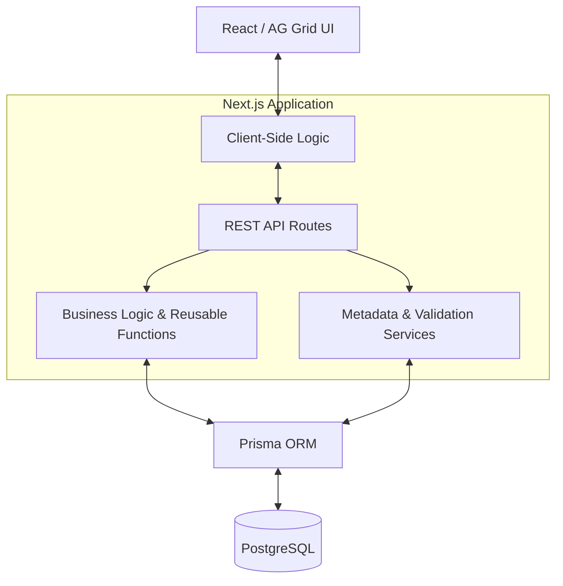

# System Architecture

## Overview

Vantage is a full-stack construction accounting application built with Next.js, React, TypeScript, Prisma, and PostgreSQL.

The application follows a layered architecture that separates user interface behavior, server-side business logic, and database operations.

A central design principle is that business logic and data integrity must be enforced by the backend rather than relying exclusively on frontend validation. This allows operations to behave consistently whether initiated through the application interface or through direct API requests.

### React / AG Grid UI

Vantage uses React and AG Grid to provide interactive data-management interfaces.

Much of the application's grid functionality is dynamically generated using metadata retrieved from the database. This metadata determines column visibility, editing behavior, input types, and other interface configurations.

The frontend also performs validation and manages application state to provide immediate feedback to users. For example, the Save button is disabled when a record contains unresolved validation errors.

These frontend checks improve usability but are not the authoritative enforcement mechanism. Server-side validation and database constraints remain responsible for protecting persisted data.

For a more detailed explanation, see [Metadata-Driven UI](https://github.com/CamBoyd/vantage-architecture/blob/main/docs/metadata-driven-ui.md).

### Next.js Application

Next.js provides the application framework, including page routing, React components, and server-side API endpoints.

Client-side logic responds to user interactions, manages interface state, and sends requests to the appropriate API endpoints.

The application uses this separation to keep presentation concerns distinct from database operations and authoritative business rules.

### REST API Routes

Vantage exposes REST API endpoints for retrieving, creating, updating, and deleting application data.

The API layer is responsible for receiving requests, validating inputs, coordinating database operations, and returning appropriate HTTP responses.

Business operations are implemented on the server, with reusable functions extracted for functionality shared across multiple routes or application domains. API handlers invoke these functions as needed, reducing duplicated logic and allowing common operations to be maintained independently of individual endpoints.

An important architectural principle is that business operations should behave consistently regardless of how they are initiated. For example, creating an accounting record through the React interface should produce the same result as submitting an equivalent request directly through an API client such as Postman.

This approach provides a consistent entry point for future integrations while keeping shared application logic separate from HTTP-specific concerns.

### Metadata and Validation Logic

Vantage stores application configuration in database metadata, allowing interface behavior and validation requirements to be defined centrally.

The application retrieves metadata to dynamically construct grid interfaces and determine how individual fields should behave.

A separate metadata-driven validation mechanism associates database routines with specific columns. When a user edits a field, the application can resolve the appropriate routine, execute validation through a server-side API, and return errors or calculated values to the interface.

For example, selecting a tax code associated with a 10% tax rate could automatically populate a $10 tax amount for a $100 invoice line.

The dynamic validation framework is still under active development and testing.

### Prisma ORM

Prisma provides the application's primary object-relational mapping and database access layer.

It is used to define relational data models, generate the TypeScript database client, and execute database operations from server-side application code.

Prisma allows the application to work with strongly typed database models while abstracting much of the underlying SQL required for standard data operations.

Database-specific routines can also be executed where additional functionality is required.

### PostgreSQL

PostgreSQL serves as Vantage's primary relational database.

It stores application records, financial data, relationships between accounting entities, and configuration metadata used throughout the system.

The database also provides relational constraints and procedural functionality supporting data integrity and validation.

The schema is organized around major construction accounting domains, including financials, vendors, customers, projects, payroll, operations, and application settings.

For more information, see [Database Design](https://github.com/CamBoyd/vantage-architecture/blob/main/docs/database-design.md).

## Architectural Design Decisions

### Server-Side Business Logic

Business rules are enforced on the server rather than relying exclusively on frontend validation. This allows business rules and validation to be enforced consistently for requests originating from both the application interface and external API clients.

Functionality shared across multiple API routes or application domains is extracted into reusable functions. This reduces duplicated code, improves maintainability, and allows shared operations to be updated independently of individual HTTP endpoints.

Separating reusable business logic from API request handling also provides a foundation for more consistent testing and future integrations.

As accounting-specific functionality is implemented, this structure is intended to support increasingly complex operations without unnecessarily duplicating business rules across the application.

### Metadata-Driven Configuration

Application metadata is stored centrally in PostgreSQL rather than defining each data-management interface separately.

This increases initial architectural complexity but improves reuse, consistency, and maintainability as the application expands.

### Separation of Responsibilities

The user interface manages presentation and interaction, the API handles business operations, and the database provides persistent storage and relational integrity.

This separation is intended to make individual components easier to develop, test, and maintain.

## Development Status

Vantage is currently in pre-launch development.

The foundational application architecture, database schema, API infrastructure, authentication, and metadata-driven grid functionality have been substantially implemented.

Much of the accounting-specific business logic remains under development, and several architectural components are continuing to evolve as additional workflows are implemented.
